<p align="center">
  
</p>

<p align="center">
  <a href="https://guruprasadgp.netlify.app/"></a>
  <a href="https://www.linkedin.com/in/guruprasadgp22/"></a>
  <a href="mailto:guruprasad6200@gmail.com"></a>
  <a href="https://guruprasadgp.netlify.app/Guruprasad_P_updated.pdf"></a>
  
</p>

<p align="center"><b>🎃 Available immediately · Bengaluru / Remote · SDE-1 · Java Backend 🎃</b></p>

---

## 🦇 About Me

I'm Guruprasad, a software developer with a Bachelor's degree in Computer Science and Engineering. I enjoy designing and building **scalable, secure and user-focused** applications.

At **Sony India Software Centre** I worked in **SAP Identity and Access Management**: user lifecycle, role-based access control, authentication, authorization and security compliance. Before that I built full-stack apps with **Java, Python, Spring Boot, Hibernate and React.js** at **KodNest**, and a **Car Rental Management System** at **DLithe**.

I'm a quick learner who likes hard problems, and I'm looking for roles as a **Software Engineer, Java, Backend, Full Stack or Python Developer**.

## 🕯️ What I Do

| | |
|---|---|
| ⚙️ **Backend & APIs** | Spring Boot REST APIs and microservices with Spring Security, JWT, JPA and PostgreSQL |
| 🖥️ **Frontend** | Responsive React.js interfaces with Vite, Material UI and Tailwind CSS |
| 🧠 **AI & ML** | Computer vision with PyTorch and YOLOv5, served through ONNX Runtime |
| 🐳 **DevOps & tooling** | Docker images, GitHub Actions for builds and scheduled jobs, Git, Maven and Linux daily |

---

## 🧪 Tech Stack

| | |
|---|---|
| **Languages** |  &nbsp;+ SQL |
| **Backend** |  &nbsp;Spring Security · JWT · Spring Cloud Gateway · Eureka · Microservices |
| **Frontend** |  |
| **Databases** |  &nbsp;+ Oracle SQL |
| **DevOps** |  |
| **AI / ML** |  &nbsp;YOLOv5 · ONNX Runtime |
| **Tools** |  &nbsp;Swagger / OpenAPI |

---

## ⚰️ Experience

### Software Developer Apprentice · Sony India Software Centre Pvt. Ltd.
📍 Bengaluru, Karnataka &nbsp;|&nbsp; 📅 Jun 2025 – Jun 2026

- Administered **SAP Identity and Access Management** across the full user lifecycle: account creation, access provisioning, role changes, password resets and deactivation
- Managed **role-based access control (RBAC)**: assigning, modifying and auditing roles under least privilege and segregation of duties
- Maintained authentication and authorization configurations, ran access reviews, resolved authorization issues and supported audits
- Handled access requests through enterprise ticketing, monitoring SLAs and documenting provisioning work

### Full Stack Development Intern · KodNest Technologies
📍 Bengaluru, Karnataka &nbsp;|&nbsp; 📅 Oct 2024 – Jun 2025

- Built backend applications with **Spring Boot, Hibernate and Django**: REST APIs, CRUD and layered architecture
- Designed responsive **React.js** interfaces integrated with backend APIs; worked with MySQL, Oracle SQL and MongoDB
- Developed **QuickNote**, a **To-Do List** and a full-stack **Currency Converter**

### Web Development Intern · DLithe Consultancy Services Pvt. Ltd.
📍 Moodabidri, Karnataka &nbsp;|&nbsp; 📅 Aug 2023 – Sep 2023

- Built a **Car Rental Management System** (React.js, PHP, SQL) where users browse vehicles, register, book rentals and manage reservations

---

## 🎃 Featured Projects

<table>
<tr>
<td width="33%" valign="top">

### 💼 [Job Board](https://github.com/guruprasadgp22/Job-Board)
Two-sided job platform that matches jobs to your resume. Pulls jobs from 6 sources every 6 hours, ranks them by match %, and lets employers review applicants ranked by fit.

`Java 21` `Spring Boot 3.5` `Spring Security` `JWT` `React 18` `PostgreSQL` `Docker`

[Live demo](https://job-board-6ev5.onrender.com/) · [API docs](https://job-board-6ev5.onrender.com/swagger-ui.html)

</td>
<td width="33%" valign="top">

### ✈️ [FlightWise AI](https://github.com/guruprasadgp22/flightwise-ai)
Flight booking platform built as 9 Spring Boot microservices behind one gateway. Plain-English flight search, seat holds during payment, PDF e-tickets, and an admin console with revenue and occupancy dashboards.

`Java 21` `Spring Cloud Gateway` `Eureka` `JWT` `PostgreSQL` `React` `Docker`

</td>
<td width="33%" valign="top">

### 🦷 [Dentes](https://github.com/guruprasadgp22/Dental-Condition-Detection-System)
AI dental condition detection. A YOLOv5 model screens panoramic X-rays for 4 conditions in under 2 seconds and produces a printable findings report.

`Python` `YOLOv5` `PyTorch` `ONNX Runtime` `OpenCV` `Flask` `Docker`

</td>
</tr>
</table>

<details>
<summary><b>🕸️ Training projects</b></summary>

- [**QuickNote**](https://github.com/guruprasadgp22/Quick-Note) · note-taking app with CRUD and persistent storage · [live](https://quick-note-phi.vercel.app/)
- [**Currency Converter**](https://github.com/guruprasadgp22/Currency-Converter) · full-stack converter with REST API integration
- **To-Do List** · task manager with CRUD and REST APIs
- **Car Rental Management System** · DLithe internship project
- **Full-Stack E-Commerce Application** · authentication, REST API and CRUD

</details>

---

## 🔮 Problem Solving

**1,700+ problems solved across 10 platforms** · [live numbers on my portfolio](https://guruprasadgp.netlify.app/#coding)

| Platform | Solved | My solutions repo |
|---|---|---|
| LeetCode | 554+ | |
| GeeksforGeeks | 714+ | [GeekforGeeks](https://github.com/guruprasadgp22/GeekforGeeks) |
| NeetCode | 258+ | [NeetCode_Practise](https://github.com/guruprasadgp22/NeetCode_Practise) |
| CodeChef | 112+ | |
| HackerRank | 50+ | |

<sub>Counts as of November 2026.</sub>

---

## 📜 Education & Certifications

**B.E. in Computer Science and Engineering** · Mangalore Institute of Technology and Engineering (MITE) · Dec 2020 – May 2024 · CGPA 7.26

| Certification | Issuer | Date |
|---|---|---|
| Java Spring Framework, Spring Boot & Spring AI (Generative AI) | Udemy | May 2026 |
| Python For Beginners Course In-Depth | Udemy | Apr 2026 |
| Artificial Intelligence for Beginners: Python and AI Basics | Udemy | Dec 2025 |
| Full Stack Development in Java and Python | KodNest Technologies | Jun 2025 |
| SQL (Intermediate), SQL (Basic), Java (Basic) | HackerRank | Dec 2024 |

---

## 👻 GitHub Activity

<p align="center">
  
</p>

<p align="center">
  
  
</p>

<p align="center">
  
</p>

<!-- COMMIT_STATS_START -->
## 📊 Daily Commit Stats — Last 30 Days

> 🕒 Last updated: `2026-11-25 05:43 UTC`

```
  Total commits   : 373
  Active days     : 30 / 30
  Avg per day     : 12.4
  Best day        : 2026-11-22  (30 commits)
```

| Date       | Day | Commits | Bar                      |
|------------|-----|---------|--------------------------|
| 2026-10-27 | Tue |      11 | `███████░░░░░░░░░░░░░` |
| 2026-10-28 | Wed |      10 | `███████░░░░░░░░░░░░░` |
| 2026-10-29 | Thu |      20 | `█████████████░░░░░░░` |
| 2026-10-30 | Fri |       4 | `███░░░░░░░░░░░░░░░░░` |
| 2026-10-31 | Sat |       1 | `█░░░░░░░░░░░░░░░░░░░` |
| 2026-11-01 | Sun |       2 | `█░░░░░░░░░░░░░░░░░░░` |
| 2026-11-02 | Mon |       2 | `█░░░░░░░░░░░░░░░░░░░` |
| 2026-11-03 | Tue |       3 | `██░░░░░░░░░░░░░░░░░░` |
| 2026-11-04 | Wed |       3 | `██░░░░░░░░░░░░░░░░░░` |
| 2026-11-05 | Thu |       2 | `█░░░░░░░░░░░░░░░░░░░` |
| 2026-11-06 | Fri |      12 | `████████░░░░░░░░░░░░` |
| 2026-11-07 | Sat |      24 | `████████████████░░░░` |
| 2026-11-08 | Sun |      22 | `███████████████░░░░░` |
| 2026-11-09 | Mon |      17 | `███████████░░░░░░░░░` |
| 2026-11-10 | Tue |      18 | `████████████░░░░░░░░` |
| 2026-11-11 | Wed |      27 | `██████████████████░░` |
| 2026-11-12 | Thu |      15 | `██████████░░░░░░░░░░` |
| 2026-11-13 | Fri |      13 | `█████████░░░░░░░░░░░` |
| 2026-11-14 | Sat |      13 | `█████████░░░░░░░░░░░` |
| 2026-11-15 | Sun |      15 | `██████████░░░░░░░░░░` |
| 2026-11-16 | Mon |       9 | `██████░░░░░░░░░░░░░░` |
| 2026-11-17 | Tue |       7 | `█████░░░░░░░░░░░░░░░` |
| 2026-11-18 | Wed |      20 | `█████████████░░░░░░░` |
| 2026-11-19 | Thu |      13 | `█████████░░░░░░░░░░░` |
| 2026-11-20 | Fri |       9 | `██████░░░░░░░░░░░░░░` |
| 2026-11-21 | Sat |      19 | `█████████████░░░░░░░` |
| 2026-11-22 | Sun |      30 | `████████████████████` |
| 2026-11-23 | Mon |       8 | `█████░░░░░░░░░░░░░░░` |
| 2026-11-24 | Tue |      21 | `██████████████░░░░░░` |
| 2026-11-25 | Wed |       3 | `██░░░░░░░░░░░░░░░░░░` |

> ⚡ Auto-updated every day via GitHub Actions
<!-- COMMIT_STATS_END -->

---

<h2 align="center">🐍 The Snake That Haunts My Contributions</h2>

<p align="center">
  
</p>

---

<p align="center">
  
</p>

<h3 align="center">🎃 Always Learning • 🕸️ Always Building • 🦇 Always Improving</h3>
